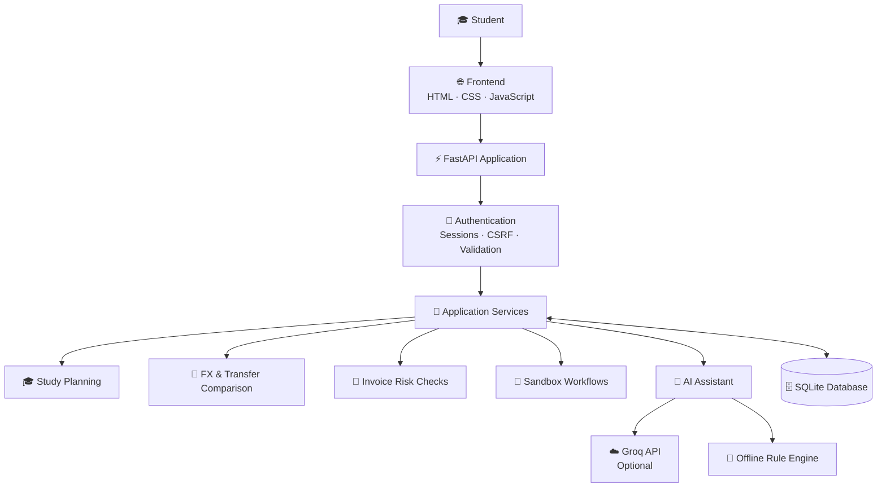

<div align="center">


<br/>

[](https://github.com/Nayeem131136/finbridge-global-ai)
&nbsp;
[](https://www.python.org/)
&nbsp;
[](https://fastapi.tiangolo.com/)
&nbsp;
[](https://www.sqlite.org/)

<br/>


<br/><br/>

[](https://www.pbcsf.tsinghua.edu.cn/)
&nbsp;
[](#-competition-context)
&nbsp;
[](https://groq.com/)
&nbsp;
[](#-limitations)

<br/>

**Team FinBridge · Nayeem & Tandra**

*Plan your study-abroad finances. Compare your options. Make informed decisions.*

</div>

---

## 📖 About

**FinBridge Global AI: Cross-Border Student Finance Assistant** is a financial-planning prototype designed to help international students understand and organize the financial side of studying abroad.

Moving abroad for education involves more than paying tuition. Students must estimate living expenses, identify funding gaps, compare transfer options, understand potential fees, plan savings, and verify payment instructions.

FinBridge brings these workflows together in a single web application. It combines a study-abroad funding planner, cost and payment comparison tools, an AI-assisted finance assistant, invoice-risk indicators, reminders, and sandbox financial workflows.

The application combines earlier prototypes into one FastAPI application, with the architectural decision documented in `docs/ARCHITECTURE_DECISION.md`.

> *Plan better. Compare carefully. Cross borders with greater financial confidence.*

### 🎯 Our Mission

Make cross-border student finance easier to understand through transparent calculations, practical planning tools, and responsible AI assistance.

## 🏆 Competition Context

<div align="center">

| Detail | Information |
|---|---|
| Competition | 2026 Shenzhen International FinTech Competition |
| Track | International Track |
| Topic | Topic C — Cross-border & Student Finance Assistant |
| Team | FinBridge |
| Team members | Nayeem, Tandra |
| Project | FinBridge Global AI |

</div>

---

## ✨ Key Features

<div align="center">

| Feature | Description |
|---|---|
| 🎓 **Study-Abroad Funding Planner** | Estimate tuition, living expenses, one-time costs, savings and available funding. |
| 💰 **Funding-Gap Analysis** | Understand confirmed and potential funding separately and estimate the remaining gap. |
| 🧮 **What-If Lab** | Explore how changes in expenses, funding or assumptions affect your plan. |
| 📊 **Plan Comparison** | Compare up to three supported study plans. |
| 🗓️ **Monthly Savings Plan** | Estimate the monthly savings needed for your target. |
| ✅ **Planning Checklist** | Organize the steps associated with your study-abroad financial plan. |
| 📄 **PDF Reports** | Generate a report of supported study-planning information. |
| 🌐 **Transfer Route Comparison** | Compare illustrative or user-entered transfer quotes and their stated assumptions. |
| 💱 **FX Rate Board** | Record rates you have seen, track their timestamps and flag potentially stale entries. |
| ⏳ **FX Timing Support** | Explore currency-related planning information; it does not predict future exchange rates. |
| 🧾 **Tuition Installment Plans** | Organize tuition payment schedules using the available planning tools. |
| 🤖 **AI Finance Assistant** | Ask supported questions and use available financial-planning tools. |
| 🧠 **Offline Rule Engine** | Keep supported assistant workflows available when live AI is unavailable. |
| 🛡️ **Invoice Risk Checker** | Flag suspicious wording, changed bank details and other potential warning signs. |
| 👤 **Account & Profile Management** | Register, sign in, manage preferences and access personal planning records. |
| 💾 **Saved Plans & Comparisons** | Create, review, edit and delete supported planning records. |
| 🔔 **In-App Reminders** | Track selected tuition deadlines, savings milestones and budget reviews. |
| 🏦 **Sandbox Wallet** | Demonstrate deposit, withdrawal and transfer workflows without moving real money. |
| 🔐 **Security Demonstration** | Explore the hash-chained audit log and its clearly labelled tamper-test simulation. |
| 🌏 **English & বাংলা UI** | Switch between supported interface languages. |

</div>

---

## 🛠️ Technology Stack

<div align="center">


</div>

| Technology | Purpose |
|---|---|
| Python | Backend logic and application services |
| FastAPI | API endpoints, request processing and application routing |
| SQLite | Persistent application data |
| SQL migrations | Versioned database schema changes |
| HTML5 & CSS3 | Frontend structure and styling |
| Vanilla JavaScript | Interactive UI and API communication |
| Groq API | Optional AI assistant with tool calling |
| Rule engine | Offline assistant fallback |
| Pytest & HTTPX | Backend testing |
| Playwright | Browser-based test scripts |
| ReportLab / pypdf | PDF-related application functionality |

---

## 🏗️ System Architecture



### 🔄 How It Works

1. A student opens the frontend and selects a planning feature.
2. The frontend communicates with the FastAPI backend.
3. The backend validates requests and checks the relevant user permissions.
4. Financial calculations and supported application operations run on the backend.
5. The assistant uses Groq when correctly configured and available, or falls back to the rule engine for supported workflows.
6. Relevant user-specific records are stored in SQLite.
7. The application returns results and planning information to the user.

**Important:** The AI can prepare a transfer, but a signed-in student must confirm it using their own account password. Guest demo transfers use a development-only PIN. All transfer and wallet operations are sandbox demonstrations.

---

## 📂 Project Structure

```text
finbridge-global-ai/
│
├── backend/
│   ├── app/
│   │   ├── main.py              # FastAPI application entry point
│   │   ├── api_user.py          # Accounts, profile and plans
│   │   ├── api_study.py         # Study-planning API
│   │   ├── studycalc.py         # Study-planning calculations
│   │   ├── studystore.py        # Study-planning data services
│   │   ├── agent.py             # Assistant orchestration
│   │   ├── tools.py             # Assistant tools
│   │   ├── auth.py              # Authentication
│   │   ├── security.py          # Security controls
│   │   ├── db.py                # Database access
│   │   ├── llm.py               # AI-provider integration
│   │   └── ...
│   │
│   ├── migrations/              # Versioned SQL migrations
│   ├── tests/                   # Backend test suite
│   ├── requirements.txt
│   ├── .env.example
│   └── check_llm.py             # Live AI connectivity check
│
├── frontend/
│   ├── index.html
│   ├── css/
│   └── js/
│       ├── main.js
│       ├── account.js
│       ├── dash.js
│       ├── ui.js
│       ├── api.js
│       ├── i18n.js
│       ├── cards.js
│       └── globe.js
│
├── eval/                        # Offline task scenarios and evaluation
├── frontend_tests/              # Playwright browser-test scripts
├── docs/                        # Technical, security and user documentation
├── run.bat                      # Windows launcher
├── run.sh                       # macOS/Linux launcher
└── README.md
```

The tree highlights major components; additional modules and documentation files are included in the repository.

---

## ⚙️ Installation & Setup

### Requirements

- Python installed on your computer. Python 3.11 is the recommended tested environment for this project.
- Git (for cloning the repository).
- VS Code or another editor.
- A modern web browser.
- Optional: a Groq API key for live AI functionality.

### 1. Clone the repository

```bash
git clone https://github.com/Nayeem131136/finbridge-global-ai.git
cd finbridge-global-ai
```

If you publish the repository under a different name, replace the URL with your actual GitHub repository URL.

### 2. Create a virtual environment

**Windows PowerShell:**

```powershell
cd backend
py -m venv .venv
.venv\Scripts\Activate.ps1
```

If PowerShell blocks activation, run this in the same terminal:

```powershell
Set-ExecutionPolicy -Scope Process Bypass
.venv\Scripts\Activate.ps1
```

**macOS / Linux:**

```bash
cd backend
python3 -m venv .venv
source .venv/bin/activate
```

### 3. Install dependencies

With the virtual environment activated:

```bash
pip install -r requirements.txt
```

### 4. Configure the environment

Copy the example configuration file.

**Windows PowerShell:**

```powershell
Copy-Item .env.example .env
```

**macOS / Linux:**

```bash
cp .env.example .env
```

Open `backend/.env` and set only the environment variables you need. The application can run without a Groq API key using supported offline rule-engine workflows.

### 5. Start FinBridge

From the `backend` directory, with the virtual environment activated:

```bash
python -m uvicorn app.main:app --port 8000
```

Then open:

- **Application:** http://localhost:8000
- **API documentation:** http://localhost:8000/docs in development, if API docs are enabled.

The database is created and migrations are applied automatically on first start, according to the project configuration.

### 6. Use the Windows shortcut

The repository also includes a `run.bat` launcher. From the repository root, you can double-click it to start the application if its environment and dependencies are configured.

For macOS/Linux, use `./run.sh` if the script has executable permission:

```bash
chmod +x run.sh
./run.sh
```

---

## 🔑 Optional: Enable the Live AI Assistant

FinBridge works without an external AI key through its supported offline rule engine. To test the live Groq integration:

1. Create or access your Groq API key through the official provider.
2. Open `backend/.env`.
3. Set the `GROQ_API_KEY` variable using your own secret key.
4. Save the file.
5. From the `backend` directory, run:

```bash
python check_llm.py
```

The script makes a real provider request. A successful `[OK]` result confirms connectivity for that test; it does not certify every AI workflow.

Start the application again:

```bash
python -m uvicorn app.main:app --port 8000
```

The application status panel should identify live AI only after a real request succeeds. Otherwise, supported workflows can fall back to the offline rule engine.

**Security:** Never paste your API key into GitHub, this README, screenshots, or public messages. Keep `backend/.env` private. Commit `.env.example`, not `.env`.

---

## 🧭 User Manual

### 👤 1. Create an account or enter demo mode

1. Open the application at `http://localhost:8000`.
2. Select **Create account** to register, or choose **Continue as demo guest**.
3. Complete the supported sign-up or guest flow.
4. If you register, sign in with your account.
5. Use the dashboard to access available planning features.

A guest session is intended for demonstration. It should not be treated as equivalent to a registered student's private account.

### 🌍 2. Complete your profile

1. Open **Profile**.
2. Enter your home country and study country.
3. Select your preferred language and currency.
4. Choose your university from the searchable sample directory, or use **Other / not listed** when available.
5. Add your study level and program if relevant.
6. Set optional budget, income and tuition-date information.
7. Save your changes.

The university directory contains sample names. Do not interpret a university listing as verification of its tuition fees, bank details or payment providers.

### 🎓 3. Create a study-abroad funding plan

1. Open **My plans** or the study-planning feature.
2. Enter tuition, living expenses and applicable one-time costs.
3. Add expected cost growth if needed.
4. Record confirmed funding separately from potential scholarships.
5. Enter your available savings and planning timeline.
6. Review the total cost, funding coverage, confirmed gap and potential gap.
7. Review the monthly savings estimate.
8. Save the plan.

**Remember:** Potential scholarships are not confirmed funding. Keep them separate when deciding whether you can afford your study plan.

### 🧮 4. Use the What-If Lab

1. Open the What-If Lab.
2. Select a supported scenario.
3. Adjust an expense, funding amount or other available input.
4. Review how the total estimated cost and funding gap change.
5. Compare the scenario with your original plan.
6. Save or export supported results if needed.

The results depend on your inputs and assumptions. They are estimates rather than guaranteed future costs.

### 📊 5. Compare study plans

1. Create or save more than one study plan.
2. Open the plan-comparison feature.
3. Select up to three plans.
4. Compare their supported cost and funding information.
5. Identify the assumptions that explain the differences.
6. Save the comparison if that option is available.

### 💱 6. Compare transfer quotes

1. Open the transfer or FX comparison feature.
2. Enter the amount and relevant currency details.
3. Add transfer quotes from providers you have independently checked.
4. Record the rate and the time you observed it.
5. Review the displayed fees and estimated recipient amount.
6. Compare the assumptions behind the quotes.
7. Verify the final rate and fees directly with the provider before transferring money.

Rates and provider information may be illustrative. Fictional providers are used for demonstration, not as real financial institutions.

### ⏳ 7. Review FX timing information

1. Open the FX rate board or related planning tool.
2. Review available rate references and recorded quote timestamps.
3. Check stale-rate indicators.
4. Compare available information against the market reference rate shown by the application.
5. Treat the output as planning information, not a forecast of future currency movements.

FinBridge does not guarantee a better exchange rate or predict the market with certainty.

### 🧾 8. Plan tuition installments

1. Open the tuition installment-planning feature.
2. Enter the applicable tuition amount and schedule details.
3. Review the installment information shown by the application.
4. Compare the schedule with your budget and expected funding.
5. Verify the official payment deadlines with your university.

### 🤖 9. Ask the AI Finance Assistant

Open **Assistant** and ask a supported question.

Example:

> Compare the cheapest way to pay 12000 USD tuition from BDT.

You can also ask:

- "Help me understand my funding gap."
- "What happens if my living expenses increase?"
- "Compare the saved payment scenarios."
- "Which details should I verify before paying an invoice?"

Review the answer and assumptions carefully. AI-generated text should explain the application’s supported data and tools, not replace independent financial verification.

### 💾 10. Save a comparison

1. Run a supported comparison.
2. Review the results.
3. Select **Save this comparison**.
4. Open **My plans** or the saved-comparisons area.
5. Confirm that the record is available to your account.

### 🧾 11. Check a potentially suspicious invoice

1. Open the invoice checker from the dashboard.
2. Enter supported invoice text or upload a text-based PDF.
3. Submit the invoice for analysis.
4. Review any warnings and the reasons provided.
5. Verify beneficiary and bank details using an independent, trusted channel before paying.

The supported PDF upload is limited to text extraction. Image-only or scanned invoice OCR is not implemented.

**A risk indicator is not proof of fraud. A clean result does not guarantee that an invoice is safe.**

### 🏦 12. Try the sandbox wallet and transfer flow

1. Open the sandbox financial feature.
2. Enter the requested amount and supported details.
3. Review the transaction information.
4. Follow the confirmation step.
5. Review the resulting sandbox record.

A signed-in student must confirm a transfer with their own account password. The public demo PIN `1234` is for guest demonstrations only and must not be used as an account password.

**No real funds move. Do not enter actual banking credentials or payment secrets.**

### 🔔 13. Review reminders

The application supports in-app reminders for selected tuition deadlines, savings milestones and budget reviews.

1. Open the reminders or dashboard section.
2. Review the reminders available to your account.
3. Check the associated dates and details.
4. Update relevant plan information when needed.

Email or push notifications are not sent by default. SMTP is optional and is documented for password-reset email configuration.

### 🔐 14. Log out and manage your account

- Use the logout control to end your session.
- Review or update supported profile fields from Profile.
- Use the supported account deletion flow if you want to delete your account and associated data.
- Keep your password and API keys private.

---

## ⚙️ Configuration Reference

Configuration is read from the environment or `backend/.env`. Actual environment variables take precedence as documented by the project.

| Variable | Purpose |
|---|---|
| `FINBRIDGE_ENV` | Development or production behavior |
| `FINBRIDGE_DB` | SQLite database path |
| `FINBRIDGE_CORS` | Allowed browser origins |
| `FINBRIDGE_SESSION_HOURS` | Session lifetime |
| `FINBRIDGE_OFFLINE` | Enable offline behavior and fixed-rate testing mode |
| `FINBRIDGE_LIVE_FX` | Enable live FX retrieval with fallback behavior |
| `GROQ_API_KEY` | Optional Groq API integration |
| `FINBRIDGE_MODEL` | Optional AI model override |
| `SMTP_HOST` | Optional mail server |
| `SMTP_PORT` | Optional mail server port |
| `SMTP_USER` | Optional mail account |
| `SMTP_PASSWORD` | Optional mail password |
| `SMTP_FROM` | Optional sender address |

Use the exact defaults and configuration details in `backend/.env.example`. Production deployment requires the additional controls documented in `docs/PRODUCTION_CHECKLIST.md`.

---

## 🧪 Testing & Evaluation

The following results were recorded in the project's 19 October 2026 review. Re-run the tests against the exact commit you publish before treating them as current.

<div align="center">

| Test category | Recorded result |
|---|---:|
| Backend automated tests | **171 passed** |
| Offline task scenarios | **36 / 36 passed** |
| Cross-user study-route isolation checks | **12 blocked** |
| Browser tests | **Rerun pending** |
| Live Groq, FX and SMTP | **Not verified in the review environment** |

</div>

### Run backend tests

From the repository root:

```bash
cd backend
python -m pytest -q
```

### Run the offline evaluation

From the repository root:

```bash
python eval/run_eval.py
```

The report is written to `eval/report.md`.

### Optional: Run the evaluation through the AI model

Configure a working Groq key first, then run:

```bash
python eval/run_eval.py --llm --delay 5
```

This test requires a live AI provider and may use provider quota.

### Browser testing

Playwright scripts are available in `frontend_tests/`. Consult `frontend_tests/README.md` for setup and supported journeys, including signup, transfer, password reset, PDF upload, CRUD operations, session expiry, guest demo and study-planning flows.

Browser tests were not rerun in the previous review environment because the required browser executable was unavailable.

**The 36 evaluation scenarios are project-authored regression cases, not an independent benchmark.**

---

## 🔐 Security & Responsible AI

FinBridge includes several application-level controls:

- scrypt password hashing.
- HttpOnly session cookies and session expiry.
- SameSite cookie configuration, with Secure cookies in production.
- Per-session CSRF tokens.
- Login rate limiting.
- User-specific data isolation.
- Password step-up for signed-in transfer and withdrawal confirmations.
- Audit events and a hash-chained audit-log demonstration.
- Backend validation and controlled sandbox operations.
- Environment-based secret configuration.

Read `docs/SECURITY_SELF_ASSESSMENT.md` and `docs/PRODUCTION_CHECKLIST.md` for the project's documented controls, limitations and remaining work.

These controls are not a substitute for an independent security audit. The prototype is not production-ready.

---

## ⚠️ Known Limitations

- The application uses SQLite rather than PostgreSQL.
- Some exchange rates, fees and provider details are illustrative.
- The university directory contains sample names, not verified tuition or payment data.
- Sandbox wallet and transfer operations do not move real money.
- Live Groq, FX and SMTP paths require verification on a connected machine.
- Browser-based tests require Playwright and the appropriate browser binaries.
- Session and rate-limit caches are in-memory and intended for a single-process prototype.
- Image OCR for invoices is not implemented; supported PDF processing is text-based.
- Bangla interface translation does not guarantee that every server message or AI response will be in Bangla.
- Production deployment requires additional testing, operational monitoring and security review.

See `docs/KNOWN_LIMITATIONS.md` for the expanded list.

---

## 🗺️ Roadmap

- [ ] Complete browser end-to-end test reruns.
- [ ] Verify live Groq tool-calling in a connected environment.
- [ ] Verify live FX retrieval and fallback behavior.
- [ ] Verify optional SMTP password-reset delivery.
- [ ] Expand independent evaluation and security testing.
- [ ] Improve verified university and payment information.
- [ ] Assess production database and deployment requirements.
- [ ] Continue accessibility, localization and usability improvements.

---

## 📚 Documentation

The repository contains additional technical and project documentation:

| Document | Purpose |
|---|---|
| `docs/ARCHITECTURE_DECISION.md` | Explains the unified FastAPI architecture decision |
| `docs/FEATURE_INTEGRATION_MATRIX.md` | Documents feature integration |
| `docs/FEATURE_GUIDE.md` | Explains study-planning features and formulas |
| `docs/TECHNICAL_DOCUMENTATION.md` | Technical implementation overview |
| `docs/SECURITY_SELF_ASSESSMENT.md` | Security controls and limitations |
| `docs/PRODUCTION_CHECKLIST.md` | Remaining production-readiness work |
| `docs/TEST_REPORT.md` | Recorded testing information |
| `docs/DEMO_SCRIPT.md` | Demonstration guidance |
| `docs/KNOWN_LIMITATIONS.md` | Detailed limitations |
| `frontend_tests/README.md` | Browser-test setup and instructions |

---

## 👨‍💻 Team FinBridge

<div align="center">

**FinBridge Global AI**

*Cross-Border Student Finance Assistant*

| Team member | Role |
|---|---|
| **Nayeem** | Team FinBridge |
| **Tandra** | Team FinBridge |

<br/>

[](https://github.com/Nayeem131136)
&nbsp;
[](https://mahdi-hasan-nayeem-portfolio.vercel.app/)

</div>

---

<div align="center">


**⭐ If you find FinBridge interesting, consider starring the repository.**

<sub>Built for the 2026 Shenzhen International FinTech Competition · International Track · Topic C</sub>

<br/>

<sub>FinBridge Global AI is a competition prototype for financial planning and education. It does not provide guaranteed financial outcomes or move real funds.</sub>

</div>
